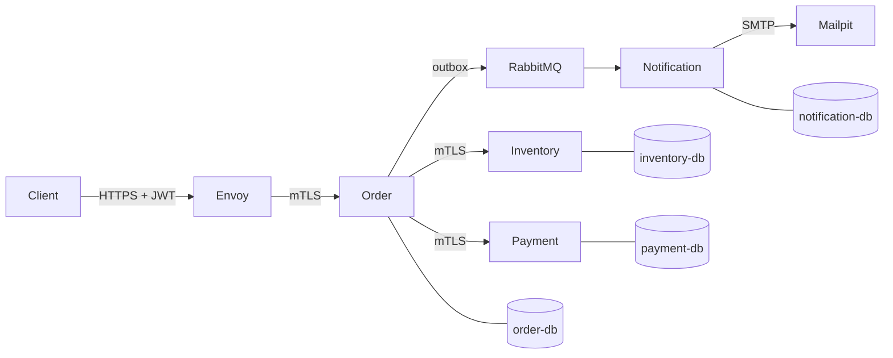

<div align="center">

# grpcshop

**A production-style checkout system built from gRPC microservices in Go and Python.**


</div>

Place an order and four services work together: **Order** runs the checkout, **Inventory** holds stock, **Payment** charges the customer and **Notification** sends the email. Every hop is encrypted, every failure is undone, and every request can be followed end to end in a single trace.

## Architecture



| Service | Language | Role |
| --- | --- | --- |
| **Order** | Go | Runs the checkout saga, stores orders and the event outbox |
| **Inventory** | Python | Products, stock reservations, admin restock |
| **Payment** | Python | Charges, refunds and cancellations |
| **Notification** | Go | Consumes order events and emails the customer |

## Quick start

Requires Docker, Go 1.26+ and Python 3.12+.

```bash
make setup   # dependencies, dev certificates, generated code
make up      # start all 15 containers
make demo    # scripted walkthrough of the API
```

Place an order:

```bash
TOKEN=$(make -s token SUB=customer-42)
curl --cacert certs/ca.crt -X POST https://localhost:8443/v1/orders \
  -H "Authorization: Bearer $TOKEN" \
  -d '{"items":[{"sku":"MOUSE","quantity":2}]}'
```

Then open the trace in Jaeger at <http://127.0.0.1:16686>, the email in Mailpit at <http://127.0.0.1:8025>, or the dashboard in Grafana at <http://127.0.0.1:3001>.

## API

| Endpoint | Access |
| --- | --- |
| `GET /v1/products` | Public |
| `POST /v1/orders` | Signed-in customer |
| `GET /v1/orders` and `GET /v1/orders/{id}` | Own orders only |
| `POST /v1/orders/{id}:cancel` | Own orders only |
| `POST /v1/products/{sku}:restock` | Admin role |

Every endpoint works as REST/JSON or native gRPC through the same Envoy port.

## What it demonstrates

- **Saga with recovery:** reserve, charge, commit; any failure is undone, and a recovery worker finishes orders interrupted by a crash.
- **No double effects:** idempotent writes, client idempotency keys, a transactional outbox and deduplicated events.
- **Zero-trust networking:** mTLS between all services, per-service caller allowlists, and certificate logins for Postgres and RabbitMQ.
- **Hardened edge:** JWT validation, rate limits, body and input limits, and REST-to-gRPC transcoding in Envoy.
- **Full observability:** OpenTelemetry traces across async hops, Prometheus metrics and alerts, and a Grafana dashboard.

## Testing

```bash
make test   # 58 Go + 48 Python integration tests (real Postgres)
make e2e    # 35 end-to-end tests through Envoy
```

## Learn more

The [project report](docs/grpcshop-project-report.pdf) covers the architecture, failure handling, security testing and known limitations in detail.

> Certificates and keys are generated locally for development and are not committed.
